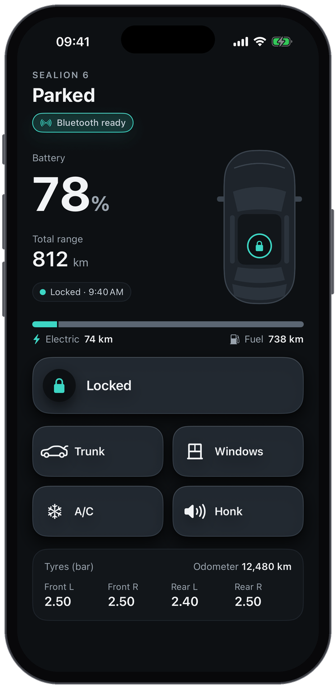
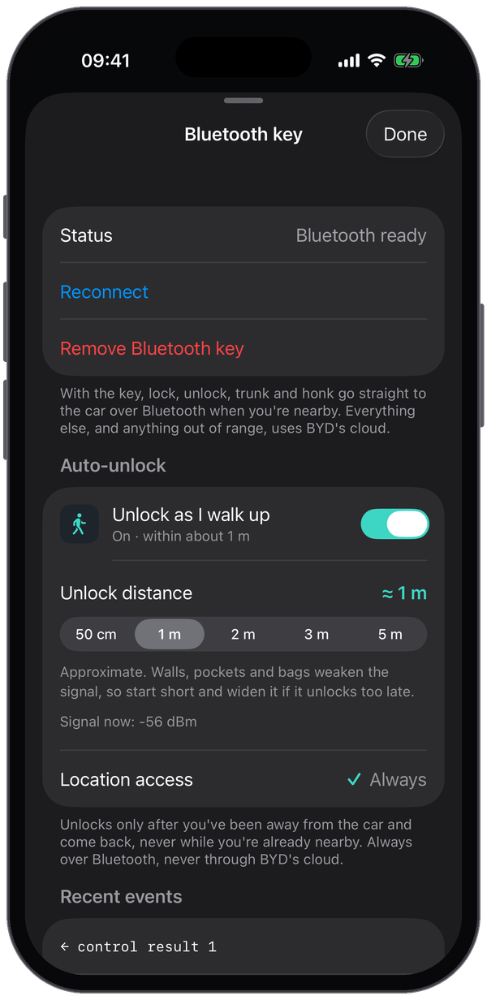
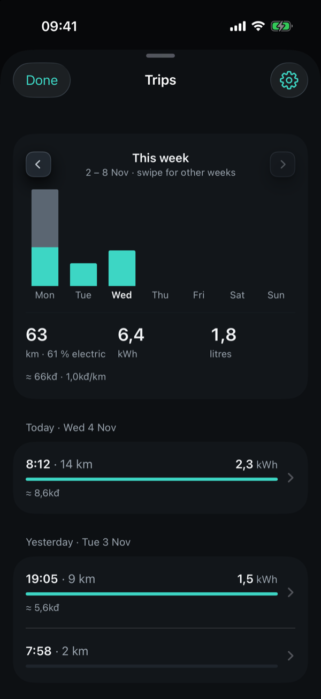
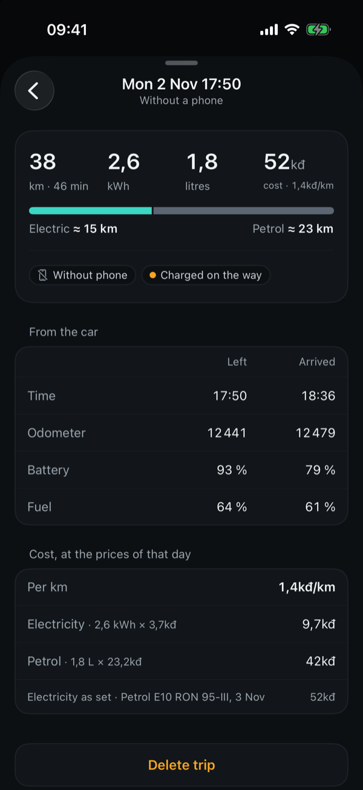
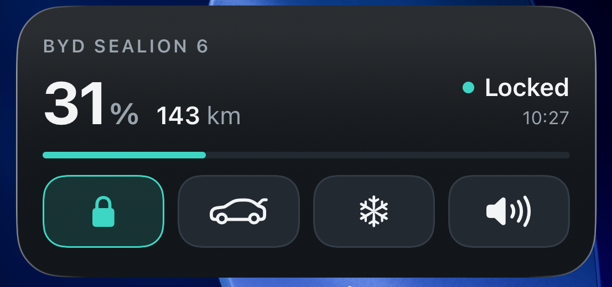

# BYD Companion

An unofficial iPhone app for BYD cars: see battery, range, locks, windows and tyres at a glance, and lock, unlock, open the trunk, vent the windows, run the A/C or honk. Near the car it can work straight over Bluetooth, and it can unlock as you walk up.

> **Unofficial and unsupported.** Not affiliated with or endorsed by BYD. It uses private, undocumented BYD interfaces that can change or stop working at any time, and it controls your car's locks. Use it at your own risk, keep your physical key with you, and test while parked.

## Screenshots

<p align="center">
  
  &nbsp;&nbsp;&nbsp;&nbsp;&nbsp;&nbsp;
  
</p>

<p align="center">
  
  &nbsp;&nbsp;&nbsp;&nbsp;&nbsp;&nbsp;
  
</p>

<p align="center">
  
</p>

## What's better than the official BYD app

- **No Face ID check every time.** Open the app and tap; it doesn't ask you to verify yourself before each command.
- **Trunk lock and unlock** from the phone.
- **Auto-unlock over Bluetooth.** Walk up to the car and it unlocks, even with the app closed. See [Auto-unlock](#4-auto-unlock-optional).
- **A trip and energy log.** Every drive with its distance, kWh, litres, electric share and cost per km, from the car's own reports. See [Trip log](#6-trip-log).
- **Works without internet near the car.** Lock, unlock, trunk and honk go straight over Bluetooth, so they still work in an underground car park with no signal.
- **Faster near the car.** A Bluetooth command takes about a second, instead of several through BYD's cloud.

## How it works

```
iPhone app ──HTTPS──▶ server.py (Cloudflare container) ◀──MQTT pushes── BYD cloud ◀──▶ car
     └──────────── Bluetooth, when nearby (lock, unlock, trunk, honk) ─────────────────▶ car
```

- **`server.py`**: a small FastAPI backend built on [pyBYD](https://github.com/jkaberg/pyBYD). It holds your BYD login, so the app never sees your password. Every request needs a shared token. It runs as one long-lived process: it logs in once, keeps pyBYD's MQTT connection to BYD open, and keeps a cache of the car's state that every push from the car updates. See [What the server returns](#what-the-server-returns).
- **The iOS app** (`ios/`): SwiftUI, iOS 17+. It talks to the server, and to the car directly over Bluetooth once you've provisioned a Bluetooth key. `ios/BYDWidget/` is the Home Screen widget; `ios/Shared/` holds the models and server client both targets use.
- **`provision_ble_key.py`**: gets a Bluetooth key from BYD by pairing a "watch" through a QR code you scan in the official BYD app. Ported from [BydBleAutoLock](https://github.com/PoorGrammerA/BydBleAutoLock).

## Requirements

- A BYD account with your car, and its remote-control PIN
- Python 3.13
- A Mac with Xcode 16 or newer, and an iPhone on iOS 17 or newer. A free Apple ID works, but apps installed with one expire after 7 days.

## 1. Run the server

```bash
python3 -m venv .venv
.venv/bin/pip install -r requirements.txt
cp .env.example .env    # then fill it in, including your region
.venv/bin/python info.py   # optional: checks your login and prints what BYD returns
```

The iPhone needs to reach the server, and the server should stay running so it can keep its BYD session and receive the car's pushes. The recommended host is [Cloudflare Containers](https://developers.cloudflare.com/containers/), which needs the Workers Paid plan (US$5/month, plus a few dollars a month for the small container). You need [Docker](https://docs.docker.com/get-docker/) running and Node.js.

```bash
cd cloudflare
npx wrangler login          # pick the account to deploy to
```

Edit `cloudflare/wrangler.jsonc`: set `account_id` to yours (`npx wrangler whoami` lists it) and the `vars` to your region, the same values as in `.env`. Remove `BYD_SKIP_COMMAND_GATE` if you don't need it (see below). Then:

```bash
npm install && npm run deploy
for v in BYD_USERNAME BYD_PASSWORD BYD_CONTROL_PIN APP_TOKEN; do grep "^$v=" ../.env | cut -d= -f2- | tr -d '\n' | npx wrangler secret put "$v"; done
npm run deploy
```

The first deploy builds the container image and creates the Worker, the loop copies your credentials into its secrets, and the second deploy starts the container with them. It prints a fixed `https://byd-companion.….workers.dev` address: that's your `SERVER_URL`. A cron trigger pings the container every 5 minutes so it never goes to sleep.

To ship a change, run `npm run deploy` again: it rebuilds the container image when `server.py` or `requirements.txt` changed and rolls out the Worker. The trip log's tables are created on first use, so no migration is needed.

Logs: `npx wrangler tail` in `cloudflare/` shows only the Worker's own requests and the keepalive's `dataAgeSeconds`, not the server's own lines. To see how the car's reports arrive, `GET /snapshots` lists the recent ones with when the car made them, when the server got them, and whether by `push` or `poll`.

If **Trunk** or **Windows** fail with "Remote command … blocked … reason=function_no_missing" or "learn_info_missing", pyBYD is refusing to send them because BYD's feature list for your car doesn't advertise them. That data is often incomplete. Set `BYD_SKIP_COMMAND_GATE=1` (in `.env`, or in the `vars` of `cloudflare/wrangler.jsonc`) to send them anyway; the app then shows what BYD answers.

To run it on your Mac instead: `.venv/bin/uvicorn server:app --host 127.0.0.1 --port 8765`, and expose it to the iPhone however you like. Run only one copy of the server per BYD account: BYD allows one push connection per login, and two servers keep kicking each other off it.

### What the server returns

`GET /status` answers from the cache at once, without talking to BYD. Besides the car's data it returns:

| Field | Meaning |
| --- | --- |
| `updatedAt` | When the car produced the data (BYD's timestamp) |
| `receivedAt` | When the server received it |
| `source` | `push` (the car sent it over MQTT), `poll` (the server asked for it), or `projection` (a command just succeeded and its expected result is shown until the car confirms it) |
| `stale` | `true` when a refresh was asked for and the car didn't answer with anything newer |
| `powerOn`, `speedKmh`, `anyDoorOpen` | Whether the car is on, how fast it's going, and whether any door or the trunk is open; auto-lock checks these before locking |

`GET /status` also returns `fuelPercent`, the fuel level in percent of the tank. It is `null` on cars that don't report it.

Three more routes feed the trip log (the Cloudflare Worker pulls the first two on its 5-minute cron; all three need the token):

| Route | Returns |
| --- | --- |
| `GET /snapshots?since=<iso8601>` | `{"snapshots": [{"at", "receivedAt", "odometerKm", "batteryPercent", "fuelPercent", "rangeElectricKm", "rangeFuelKm", "powerOn", "charging", "source"}], "serverStartedAt"}`: the last 300 changes of the car's state (a snapshot is kept whenever the car turns on or off, the odometer moves or charging starts or stops), ascending by `at`, after `since` when given. In memory only, so it empties when the container restarts. |
| `GET /prices` | `{"petrol": {"product": "E10 RON 95-III", "zone": 1, "vndPerLitre", "source", "cycle", "fetchedAt", "stale"}, "electricityHint": {"tariffFrom", "vatPercent", "tiersVndPerKwh", "tierUpToKwh"}, "capacityHint": {"model", "batteryKwh", "tankLitres"}}`: the Petrolimex zone 1 price of the petrol the car takes, the EVN household tariff ladder as a hint, and the battery and tank sizes known for the model (`null` for unknown models). |
| `GET /energy` | `{"last50km": {"evKwh", "petrolLitres", "avgEvKwhPer100km", "avgPetrolLPer100km", "electricSharePercent"}, "lifetime": {"avgEvKwhPer100km", "avgPetrolLPer100km", "totalMileageKm"}, "updatedAt"}`: BYD's own consumption figures, cached 10 minutes; 503 when BYD doesn't answer and nothing is cached yet. |

The petrol price is scraped from [webgia.com](https://webgia.com/gia-xang-dau/) and, when that fails, from the [vietfuel-api](https://vietfuel-api.tranqui.workers.dev/api/fuel-prices/petrolimex) and [thiennhat-gia-xang-dau](https://github.com/thiennhatgroup/thiennhat-gia-xang-dau) JSON mirrors. It is checked every 6 hours, hourly on Thursday afternoons and evenings (Vietnam time) when the state adjusts prices; when every source fails the last good value is served with `stale: true`.

`GET /status?refresh=true` asks the car for a new report and waits for one that is newer than what the cache had (up to about 25 seconds), so it never returns BYD's old cached snapshot. If the car doesn't answer, it returns the cache with `stale: true`. The server also asks the car for a report a few seconds after every command, and whenever nothing has arrived for a while: `BYD_POLL_ACTIVE_MINUTES` (default 5) while the car is on or charging, `BYD_POLL_MINUTES` (default 15) while it is parked. The car sends almost nothing on its own, even while driving, so the cache is about that old at worst while the car is reachable. A car that doesn't answer is asked again only after another interval. The app asks the car for a new report itself when it opens and the server's copy is more than 5 minutes old.

### Trip log

The Worker keeps a trip and energy log in the SQLite of the same Durable Object that hosts the container, so it survives container restarts and both phones read one log. Every 5 minutes the cron pulls the container's `/snapshots` (odometer, battery, fuel, power state at each change), `/prices` (the current petrol price and the car's battery and tank sizes) and, once an hour, `/energy` (BYD's last-50 km figures), then:

- turns each power-on → power-off pair with at least 1 km into a trip (`source: "car"`), and an odometer jump between two power-off reports into a `coarse` trip;
- works out km, kWh (battery drop × capacity), litres (fuel drop × tank), the electric and petrol km (a learnt kWh/km rate splits mixed trips), flags such as `chargedDuringTrip`, `refuelledDuringTrip` and `tooShortToMeasure`, and the cost at the prices in force when the trip closed (a petrol override in settings wins; no cost until a price per kWh is set);
- attaches the phones' departure and arrival events to the trip they overlap (within 15 minutes), which gives the trip its phone, exact times and locations;
- calibrates the battery and tank sizes from `/energy` against the percentage drops over the same 50 km, adopting a measured value after three readings within 10 % unless you set one by hand.

Routes the Worker answers itself (same bearer token; everything else still goes to `server.py`):

| Route | What it does |
| --- | --- |
| `GET /trips?since=&limit=` | Trips newest first, the open trip, settings, cached prices and `serverTime`. With `since`, soft-deleted trips are included (with `deletedAt`) so clients can drop them. |
| `DELETE /trips/:id` | Soft-deletes a trip. |
| `POST /trips/events` | `{"phoneId","phoneName","events":[{"kind":"departure"\|"arrival","at","lat","lon"}]}`; stores them, attaches what it can and answers `{"attached":n}`. Events with no trip yet are kept and attached at a later pull. |
| `GET` / `PUT /settings` | `priceKwh`, `petrolOverrideVndPerLitre`, `batteryKwh`, `tankLitres`, `batterySource`, `tankSource` (`model`, `measured` or `manual`), `notifyOnTrip`. `PUT` merges; editing a capacity by hand marks it `manual`. |
| `GET /phones` | The phones seen and the current leader. |
| `POST /lease` | `{"phoneId","phoneName","kind":"car","ttlSeconds":120}` → `{"granted":bool,"leader":{...}}`. |
| `POST /trips/sync` | What the cron runs: pull snapshots and prices now. Handy after `wrangler dev`. |

**Two phones in the car.** The car holds one authenticated Bluetooth session at a time, so the phone that owns it is the leader and the only one that auto-unlocks, auto-locks and posts departure and arrival events. The lease only records that: the leader posts `POST /lease` when its link is ready and renews it on each signal tick; the Worker grants the lease to the first phone or the current holder and refuses other phones while it is live, so the other phone can show "Hieu's iPhone is driving" and stay quiet. With no internet the Bluetooth rule still decides on its own.

## 2. Build the app

```bash
cp ios/Config.local.example.xcconfig ios/Config.local.xcconfig
```

Fill in `ios/Config.local.xcconfig` (it's gitignored):

| Setting | What it is |
| --- | --- |
| `APP_DISPLAY_NAME` | The name under the icon |
| `APP_BUNDLE_ID` | Any identifier unique to you, e.g. `com.yourname.byd-companion` |
| `DEVELOPMENT_TEAM` | Your team ID, from Xcode › Settings › Accounts |
| `SERVER_URL` | The server address. Write `//` as `/$()/`, e.g. `https:/$()/byd-companion.you.workers.dev` |
| `SERVER_TOKEN` | The `APP_TOKEN` from your `.env` |

Then open `ios/BYDCompanion.xcodeproj`, pick your iPhone and press Run.

### Custom icon

The default icon is `ios/BYDCompanion/Assets.xcassets/AppIcon.appiconset/AppIcon.png`. To use your own without changing the repo:

1. Create `ios/BYDCompanion/Local.xcassets/MyIcon.appiconset/` (gitignored). Put a 1024×1024 PNG with no transparency in it, plus a `Contents.json` like the one next to the default icon.
2. Set `APP_ICON_NAME = MyIcon` in `ios/Config.local.xcconfig`.

The accent colour and other colours are in `ios/Shared/Theme.swift`.

## 3. Bluetooth key (optional)

With a Bluetooth key, lock, unlock, opening the trunk and honking go straight to the car when you're nearby: faster, and they work without internet.

1. Run `.venv/bin/python provision_ble_key.py`. It opens a QR code.
2. In the official BYD app, scan it and tap Submit.
3. The key is saved to `ble_key.json`. That file is a car key: it's gitignored, never share it.
4. Give the server the key. On Cloudflare: `npx wrangler secret put BLE_KEY_JSON < ../ble_key.json` in `cloudflare/`, then `npm run deploy`. On your Mac, just restart `server.py`.
5. In the app, tap the Bluetooth chip under the headline, then **Import key from Mac server**. The key is stored in the iPhone's Keychain. You can delete the `BLE_KEY_JSON` secret afterwards.

Commands that aren't confirmed by the car within 3 seconds are reported, not retried through the cloud, because the car may already have acted.

## 4. Auto-unlock (optional)

In the Bluetooth sheet, turn on **Unlock as I walk up**. It needs no location access: it only uses Bluetooth.

- When the Bluetooth link to the car drops, the app notes the time. Driving away, connected the whole time, never starts that clock.
- iOS keeps the reconnect request pending and wakes the app when the car is back in range, even if the app is closed.
- If the link was gone for at least 5 minutes, the app sends one Bluetooth unlock once the signal stays above the chosen distance (50 cm to 5 m) for 1.5 seconds. Shorter dropouts, such as the signal fading through a wall while you're at home, never unlock. It never unlocks through the cloud, and a quiet notification tells you it happened.
- It can't run after you force-quit the app, until you open it again.

The distances are rough guesses from signal strength: walls, pockets and bags change them. The Bluetooth sheet shows the live signal to help you pick one.

## 5. Auto-lock (optional)

In the Bluetooth sheet, turn on **Lock as I walk away**. Like auto-unlock, it needs no location access: it only watches the Bluetooth signal while the phone is connected to the car.

- Once the signal has been stronger than the chosen distance (50 cm to 2 m, default 2 m) for a moment, the app knows you were at the car.
- When the signal then stays weaker than that for 3 seconds, it sends one Bluetooth lock, never through BYD's cloud, and a quiet notification tells you whether the car confirmed it. One lock per visit: it won't lock again until you've been at the car again.
- If the Bluetooth link drops before that, it locks when the link comes back within 2 minutes, if you're still beyond the chosen distance.
- Before locking it asks the server for the car's latest report. If that report is less than 5 minutes old and says the car is on or moving, it doesn't lock and tells you why. If it says a door or the trunk is open, it waits: every 10 seconds it asks the car for a fresh report and locks as soon as the door is shut, giving up after 2 minutes or if you come back. If the car is already locked it stays quiet. An old or unreachable report never blocks the lock.
- No auto-lock within 60 seconds of any Bluetooth command from the app or widget, so an unlock to grab something isn't undone straight away.
- iOS can suspend the app in the background, or end it while it's connected, so a walk-away can go unseen. When iOS relaunches an ended app for the link's drop, that counts as the link dropping. As a safety net, whenever the link drops without a lock that visit, the app asks the server for a fresh report. If the car is off and unlocked, a notification offers a **Lock** button (long-press it) that locks through BYD's cloud; if a door is open it only tells you. At most one such notification every 10 minutes.

The Bluetooth sheet's **Recent events** are also written, with timestamps, to the system log (subsystem `byd-companion`) and to `Documents/link-log.txt` in the app's container. With the phone plugged into the Mac you can copy that file without root:

```bash
xcrun devicectl device copy from --device <udid> --domain-type appDataContainer --domain-identifier <bundle id> --source Documents/link-log.txt --destination link-log.txt
```

It locks only when the phone that holds the key walks away. If you leave the phone in the car, nothing happens. Loading the trunk or sitting inside keeps the signal strong, so it doesn't lock. Like auto-unlock, it can't run after you force-quit the app. In demo mode (`-demo YES`), long-press **Signal now** in the Bluetooth sheet to step the pretend signal down and watch it work.

## 6. Trip log

The home screen's **Trips** card shows this month's distance, energy and cost; tap it for the log. Nothing to set up: the server derives trips from the car's own reports (a power-on to power-off pair with the odometer moving), so drives are logged even when no phone is in the car.

- **What's logged.** For each trip: the time, odometer, battery and fuel percentages at departure and arrival, from which the app shows kilometres, kWh, litres, the electric share and, when prices are known, the cost and cost per km. Each trip keeps the prices of its day, so old trips never change. Trips too short for the car's percentages to move show no energy or cost.
- **With the phone.** When the phone connects to the car over Bluetooth it tells the server it left, and when the link drops, that it arrived. The server attaches that to the trip: exact times and which phone drove. Events wait on the phone until it's online, and about ten minutes after a drive iOS lets the app fetch the finished trip in the background. Trips driven without any phone show a barred-phone glyph.
- **Two phones.** Both read the same log. The phone connected to the car holds a short lease on it (renewed every 30 s) and is shown as driving; while another phone holds the lease, auto-unlock and auto-lock on this one stay quiet, so a passenger's phone never unlocks or locks the car. Each phone has a name, the device's by default, shown on the trips it drove.
- **Settings** (the gear in the Trips sheet): your electricity price per kWh; the petrol price, fetched by the server from public Vietnamese sources (E10 RON 95-III, zone 1) with an override; the battery and tank sizes, seeded from the car model and editable; this phone's name; and a quiet notification when a trip is logged.

All amounts are in thousand dong (`758kđ`, `1.8kđ/km`). In demo mode (`-demo YES`), **Simulate a trip** at the bottom of the trip settings drives the pretend car and logs the result.

## Regions and tested cars

Set `BYD_BASE_URL`, `BYD_COUNTRY_CODE` and `BYD_TIME_ZONE` in `.env` for your region (examples in `.env.example`). A wrong region usually fails login with code 3008.

| | Status |
| --- | --- |
| Cloud status and commands | Used with a BYD Sealion 6 plug-in hybrid in Vietnam |
| Bluetooth key provisioning | Works on the Vietnam server |
| Bluetooth commands | Confirmed upstream on a Korean BYD ATTO 3 only; not yet confirmed on other models |

Reports for other cars and regions are welcome.

## What's private

Never commit these; they're all in `.gitignore`: `.env`, `ios/Config.local.xcconfig`, `ble_key.json`, `.watch_token.json`, `.watch_device_id`, `watch_qr.png`.

## Credits and licence

- [pyBYD](https://github.com/jkaberg/pyBYD) for the BYD cloud API.
- [BydBleAutoLock](https://github.com/PoorGrammerA/BydBleAutoLock) for the Bluetooth key protocol and provisioning flow. See [THIRD_PARTY_NOTICES.md](THIRD_PARTY_NOTICES.md).

MIT licence: see [LICENSE](LICENSE). BYD and the BYD logo shown in the default app icon are trademarks of BYD Company Ltd.; this is fan-made and unofficial.
