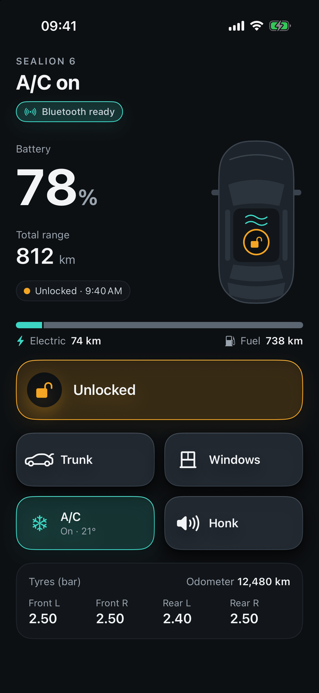

# BYD Companion

An unofficial iPhone app for BYD cars: see battery, range, locks, windows and tyres at a glance, and lock, unlock, open the trunk, vent the windows, run the A/C or honk. Near the car it can work straight over Bluetooth, and it can unlock as you walk up.

> **Unofficial and unsupported.** Not affiliated with or endorsed by BYD. It uses private, undocumented BYD interfaces that can change or stop working at any time, and it controls your car's locks. Use it at your own risk, keep your physical key with you, and test while parked.

## Screenshots

<p align="center">
  
  &nbsp;&nbsp;&nbsp;&nbsp;&nbsp;&nbsp;
  
  &nbsp;&nbsp;&nbsp;&nbsp;&nbsp;&nbsp;
  
</p>

## What's better than the official BYD app

- **No Face ID check every time.** Open the app and tap; it doesn't ask you to verify yourself before each command.
- **Trunk lock and unlock** from the phone.
- **Auto-unlock over Bluetooth.** Walk up to the car and it unlocks, even with the app closed. See [Auto-unlock](#4-auto-unlock-optional).
- **Works without internet near the car.** Lock, unlock, trunk and honk go straight over Bluetooth, so they still work in an underground car park with no signal.
- **Faster near the car.** A Bluetooth command takes about a second, instead of several through BYD's cloud.

## Home Screen widget

A full-width widget shows battery, range and the lock state, with **Lock**, **Trunk**, **A/C** and **Honk** buttons that work without opening the app. Add it from the widget gallery (long-press the Home Screen, tap **+**, pick the app).

<p align="center">
  
</p>

Widget buttons always go through the server, since an extension can't use the car's Bluetooth key. The widget re-reads the car every 15 minutes, right after a command, and whenever the app loads or sends one. If the server can't be reached it dims the last known values and disables the buttons.

## How it works

```
iPhone app ──HTTPS──▶ server.py (on Vercel) ──▶ BYD cloud ──▶ car
     └──────────── Bluetooth, when nearby (lock, unlock, trunk, honk) ────────▶ car
```

- **`server.py`**: a small FastAPI backend built on [pyBYD](https://github.com/jkaberg/pyBYD). It holds your BYD login, so the app never sees your password. Every request needs a shared token.
- **The iOS app** (`ios/`): SwiftUI, iOS 17+. It talks to the server, and to the car directly over Bluetooth once you've provisioned a Bluetooth key. `ios/BYDWidget/` is the Home Screen widget; `ios/Shared/` holds the models and server client both targets use.
- **`provision_ble_key.py`**: gets a Bluetooth key from BYD by pairing a "watch" through a QR code you scan in the official BYD app. Ported from [BydBleAutoLock](https://github.com/PoorGrammerA/BydBleAutoLock).

## Requirements

- A BYD account with your car, and its remote-control PIN
- Python 3.13
- A Mac with Xcode 16 or newer, and an iPhone on iOS 17 or newer. A free Apple ID works, but apps installed with one expire after 7 days.

## 1. Run the server

```bash
python3 -m venv .venv
.venv/bin/pip install -r requirements.txt
cp .env.example .env    # then fill it in, including your region
.venv/bin/python info.py   # optional: checks your login and prints what BYD returns
```

The iPhone needs to reach the server, so deploy it to [Vercel](https://vercel.com) as a serverless function (the free Hobby plan works). Install the [Vercel CLI](https://vercel.com/docs/cli), then:

```bash
vercel --prod
for v in BYD_USERNAME BYD_PASSWORD BYD_CONTROL_PIN APP_TOKEN BYD_BASE_URL BYD_COUNTRY_CODE BYD_LANGUAGE BYD_TIME_ZONE; do grep "^$v=" .env | cut -d= -f2- | tr -d '\n' | vercel env add "$v" production --force; done
vercel --prod
```

The first deploy creates the project, the loop copies your `.env` into its environment variables, and the second deploy picks them up. It prints a fixed `https://….vercel.app` address: that's your `SERVER_URL`. On Vercel the server logs in to BYD on each cold start.

If **Trunk** or **Windows** fail with "Remote command … blocked … reason=function_no_missing" or "learn_info_missing", pyBYD is refusing to send them because BYD's feature list for your car doesn't advertise them. That data is often incomplete. Set `BYD_SKIP_COMMAND_GATE=1` (in `.env`, or as a Vercel environment variable) to send them anyway; the app then shows what BYD answers.

To run it on your Mac instead: `.venv/bin/uvicorn server:app --host 127.0.0.1 --port 8765`, and expose it to the iPhone however you like.

`cloudflare/` has an alternative Cloudflare Containers setup (needs the Workers Paid plan): set the region in `cloudflare/wrangler.jsonc`, add the secrets with `npx wrangler secret put`, then run `npm install && npm run deploy` in that folder.

## 2. Build the app

```bash
cp ios/Config.local.example.xcconfig ios/Config.local.xcconfig
```

Fill in `ios/Config.local.xcconfig` (it's gitignored):

| Setting | What it is |
| --- | --- |
| `APP_DISPLAY_NAME` | The name under the icon |
| `APP_BUNDLE_ID` | Any identifier unique to you, e.g. `com.yourname.byd-companion` |
| `DEVELOPMENT_TEAM` | Your team ID, from Xcode › Settings › Accounts |
| `SERVER_URL` | The server address. Write `//` as `/$()/`, e.g. `https:/$()/byd-app-abc.vercel.app` |
| `SERVER_TOKEN` | The `APP_TOKEN` from your `.env` |

Then open `ios/BYDCompanion.xcodeproj`, pick your iPhone and press Run.

### Custom icon

The default icon is `ios/BYDCompanion/Assets.xcassets/AppIcon.appiconset/AppIcon.png`. To use your own without changing the repo:

1. Create `ios/BYDCompanion/Local.xcassets/MyIcon.appiconset/` (gitignored). Put a 1024×1024 PNG with no transparency in it, plus a `Contents.json` like the one next to the default icon.
2. Set `APP_ICON_NAME = MyIcon` in `ios/Config.local.xcconfig`.

The accent colour and other colours are in `ios/BYDCompanion/Theme.swift`.

## 3. Bluetooth key (optional)

With a Bluetooth key, lock, unlock, opening the trunk and honking go straight to the car when you're nearby: faster, and they work without internet.

1. Run `.venv/bin/python provision_ble_key.py`. It opens a QR code.
2. In the official BYD app, scan it and tap Submit.
3. The key is saved to `ble_key.json`. That file is a car key: it's gitignored, never share it.
4. Give the server the key. On Vercel: `vercel env add BLE_KEY_JSON production < ble_key.json`, then `vercel --prod`. On your Mac, just restart `server.py`.
5. In the app, tap the Bluetooth chip under the headline, then **Import key from Mac server**. The key is stored in the iPhone's Keychain. You can remove `BLE_KEY_JSON` from Vercel afterwards.

Commands that aren't confirmed by the car within 3 seconds are reported, not retried through the cloud, because the car may already have acted.

## 4. Auto-unlock (optional)

In the Bluetooth sheet, turn on **Unlock as I walk up** and allow location **Always**.

- Each time the phone connects to or disconnects from the car, it remembers that spot and watches a ~150 m zone around it. iOS wakes the app there even if it's closed.
- Leaving the zone while not connected arms auto-unlock. Driving away, connected the whole time, doesn't.
- When you come back, the app reconnects and sends one Bluetooth unlock once the signal stays above the chosen distance (50 cm to 5 m) for 1.5 seconds. It never unlocks through the cloud, and a quiet notification tells you it happened.

The distances are rough guesses from signal strength: walls, pockets and bags change them. The Bluetooth sheet shows the live signal to help you pick one.

## Regions and tested cars

Set `BYD_BASE_URL`, `BYD_COUNTRY_CODE` and `BYD_TIME_ZONE` in `.env` for your region (examples in `.env.example`). A wrong region usually fails login with code 3008.

| | Status |
| --- | --- |
| Cloud status and commands | Used with a BYD Sealion 6 plug-in hybrid in Vietnam |
| Bluetooth key provisioning | Works on the Vietnam server |
| Bluetooth commands | Confirmed upstream on a Korean BYD ATTO 3 only; not yet confirmed on other models |

Reports for other cars and regions are welcome.

## What's private

Never commit these; they're all in `.gitignore`: `.env`, `ios/Config.local.xcconfig`, `ble_key.json`, `.watch_token.json`, `.watch_device_id`, `watch_qr.png`.

## Credits and licence

- [pyBYD](https://github.com/jkaberg/pyBYD) for the BYD cloud API.
- [BydBleAutoLock](https://github.com/PoorGrammerA/BydBleAutoLock) for the Bluetooth key protocol and provisioning flow. See [THIRD_PARTY_NOTICES.md](THIRD_PARTY_NOTICES.md).

MIT licence: see [LICENSE](LICENSE). BYD and the BYD logo shown in the default app icon are trademarks of BYD Company Ltd.; this is fan-made and unofficial.
